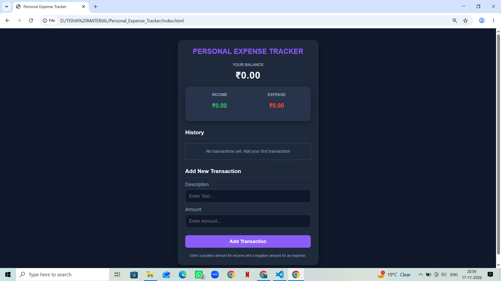
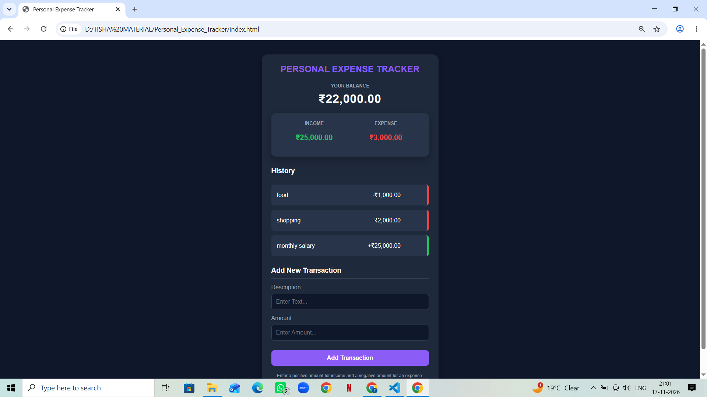
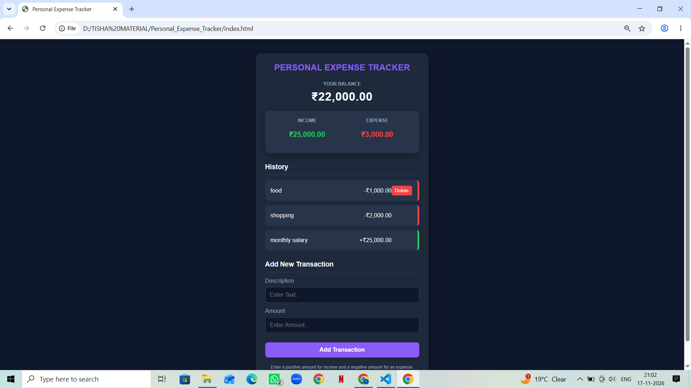

# 💰 Personal Expense Tracker

## 1. Project Description
The **Personal Expense Tracker** is a web-based application developed using HTML, CSS, and JavaScript. It helps users manage daily income and expenses by adding and deleting transactions and tracking their financial balance. Browser Local Storage saves transaction records between visits.

## 2. Project Objectives
- Develop a simple application for managing personal finances.
- Calculate total income, total expenses, and available balance.
- Maintain a record of financial transactions.
- Validate user input.
- Store transaction details using browser Local Storage.
- Practise collaborative development using Git and GitHub.

## 3. Team Members and Contributions

| Team Member | GitHub Username | Contributions |
|---|---|---|
| Tisha Garg (Student 1) | [tisha-garg12](https://github.com/tisha-garg12) | Transaction form validation, description and amount validation, transaction ID generation, and INR currency formatting |
| Vanshika Sharma (Student 2) | [vanshikasharma-droid](https://github.com/vanshikasharma-droid) | Transaction history styling, responsive design, Local Storage validation, and delete-button accessibility |

## 4. Features
1. **Add Transaction:** Add income and expense transactions.
2. **Delete Transaction:** Remove unwanted transactions.
3. **Calculate Balance:** Automatically calculate the remaining balance.
4. **Total Income:** Display total income.
5. **Total Expenses:** Display total expenses.
6. **Transaction History:** Display added transactions.
7. **Local Storage:** Save transaction data in the browser.
8. **Input Validation:** Reject empty descriptions, invalid amounts, and zero-value transactions.
9. **INR Currency Formatting:** Display amounts in Indian Rupees (₹).
10. **Responsive Design:** Adapt the interface to different screen sizes.

## 5. Technologies Used

| Technology | Purpose |
|---|---|
| HTML5 | Structure of the application |
| CSS3 | Styling and responsive layout |
| JavaScript | Application functionality and calculations |
| Local Storage | Persistent browser-side storage |
| Git | Version control |
| GitHub | Repository hosting and collaboration |

## 6. Project Structure

```text
Personal-Expense-Tracker/
├── index.html
├── style.css
├── script.js
├── README.md
├── CONTRIBUTING.md
├── .gitignore
└── screenshots/
    ├── home-page.png
    ├── transaction-history.png
    └── delete-transaction.png
```

## 7. Installation and Execution Instructions

### Step 1: Clone the repository
```bash
git clone https://github.com/tisha-garg12/Personal-Expense-Tracker.git
```

### Step 2: Open the project folder
```bash
cd Personal-Expense-Tracker
```

### Step 3: Open in Visual Studio Code
```bash
code .
```

### Step 4: Run the application
Open `index.html` in a web browser. Alternatively, use the **Live Server** extension in Visual Studio Code and select **Open with Live Server**. No database setup or additional package installation is required.

## 8. Application Screenshots

### 8.1 Home Page / Empty State
The home page displays the balance, income, expenses, transaction history area, and form for adding a transaction.



### 8.2 Transaction History and Financial Summary
This screenshot shows example transactions and the updated income, expense, and balance totals.



### 8.3 Delete Transaction
The transaction history includes a Delete control for removing an individual transaction.



## 9. Sample Output

The following values are shown in the supplied transaction-history screenshot:

| Description | Amount | Type |
|---|---:|---|
| Monthly salary | ₹25,000.00 | Income |
| Shopping | -₹2,000.00 | Expense |
| Food | -₹1,000.00 | Expense |

**Financial Summary:**
- Total Income: ₹25,000.00
- Total Expenses: ₹3,000.00
- Available Balance: ₹22,000.00

## 10. Git and GitHub Collaboration
- Created a public GitHub repository.
- Created separate feature branches for both team members.
- Used meaningful commits to track changes.
- Created Pull Requests (PRs).
- Reviewed each other's code.
- Merged approved changes into the `main` branch.
- Demonstrated and resolved a merge conflict.
- Documented the project using Markdown.

## 11. Conclusion
The Personal Expense Tracker demonstrates how a web application can be used to manage personal income and expenses. Through this project, the team practised HTML, CSS, JavaScript, Local Storage, Git, GitHub, branching, commits, Pull Requests, code reviews, merge conflict resolution, and Markdown documentation.

## 12. Repository Link
[Personal Expense Tracker on GitHub](https://github.com/tisha-garg12/Personal-Expense-Tracker)
